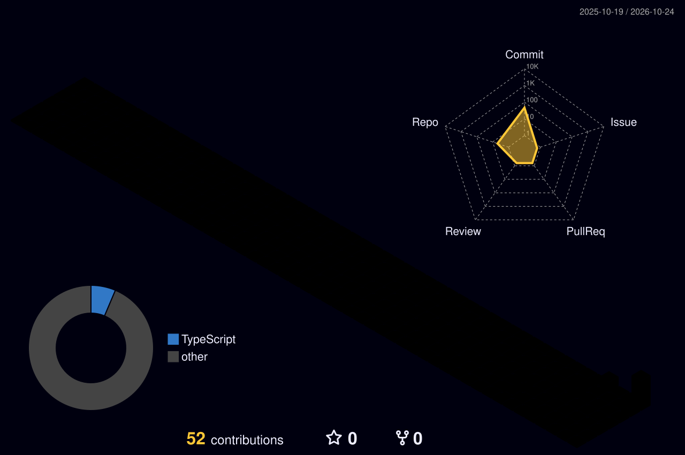

 

  

  

# Gopal Krishna

### Data Analyst | Excel • SQL • Power BI

📍 Agra, Uttar Pradesh, India · 🎓 Student

---

  

## About Me

I'm Gopal Krishna, a student developing practical data analysis and visualization skills. I enjoy exploring technology, learning new tools, and turning data into useful insights.

---

## Skills

- **Microsoft Excel**
- **SQL**
- **Power BI**
- **Python**

---

## Featured Project

### Amazon Sales Analysis Dashboard

An exploratory sales analytics project focused on sales performance, order status, product categories, and business insights.

*Add your project repository link here when it is ready.*

---

## Let's Connect

- **LinkedIn:** [Connect with me](https://www.linkedin.com/in/gopal-krishna-217b80176)
- **Email:** [gopalkrishnabietian@gmail.com](mailto:gopalkrishnabietian@gmail.com)

---

## 🌆 My 3D Contribution Graph

  

Portfolio built with Markdown and SVG. GitHub may restrict certain SVG animations. Profile statistics will be added only when verified.
